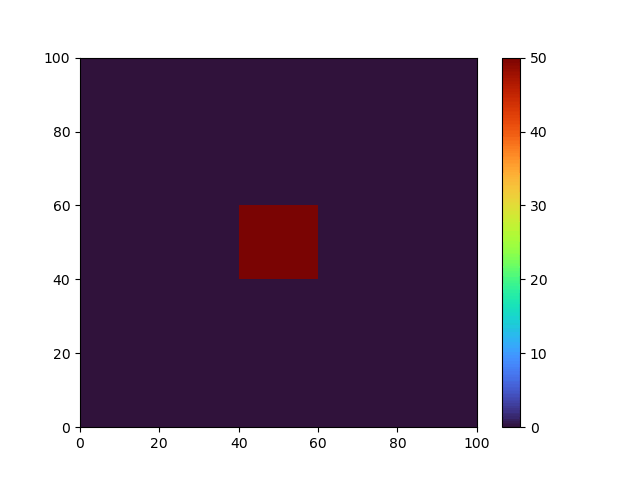

# Heat Equation in 2D

This example considers,
```math
\begin{align*}
\frac{\partial u}{\partial t} &= \alpha \Delta u  & \text{in} & \ \Omega = (0,10) \times (0,10) \ \text{for} \ t > 0\\
u &= 0                                            & \text{on} & \ \partial \Omega \ \text{for} \ t > 0\\
u &= f(x,y)                                       & \text{in} & \ \Omega \ \text{at} \ t = 0,
\end{align*}
```
where $`f`$ is given by
```math
f(x,y) =
\begin{cases}
50 &\text{if } 4 \le x \le 6, 4 \le y \le 6,\\
0 &\text{else.}
\end{cases}
```

**Running** The binaries take the mesh extents as positional
paramters. Whether to output the solution at every step and $`\alpha`$
are additional optional parameters.

For example, to run with implicit time integration using $`\alpha = 1.5`$ and outputting the solution at each step:
```bash
$ mpirun -np 4 ./heat-implicit 100 100 -d 1.5 -o true
```
Similarly, to run with explicit time integration:
```bash
$ mpirun -np 4 ./heat-explicit 100 100 -d 1.5 -o true
```

The utilities in [utility directory](./util) can be used to visualize the solutions.


**Mesh** The mesh is a simple 2D specialization of the `narray`
topology [mesh](./mesh.hh).  In addition to defining the mesh,
variables are declared for the mesh and coloring slots, as well as
field definitions that will be used to store $`u^k`$ and $`u^{k+1}`$.

    inline mesh::slot m;
    inline mesh::cslot coloring;

    inline std::array<field<double>::definition<mesh, mesh::vertices>, 2> ud;

**Control Policy** The control policy for this example can be found in
[control policy](./control.hh). `initialize`,`advance`, and `finalize`
control points are declared and state is added to store the
`flecsolve::vec::topo_view` instances.  These provide a vector interface to
the fields stored on mesh and will be backed by the field definitions
declared previously.  A helper function is added that will be used to
intialize these once the mesh has been allocated:

    void initialize_vectors() {
	    u_.emplace(flecsolve::vec::make(m, ud[0](m)));
	    unew_.emplace(flecsolve::vec::make(m, ud[1](m)));
    }

**Operator** The operator used to apply $`\alpha \Delta`$ to a vector is defined in [heat.hh](./heat.hh):

    struct heat_op : flecsolve::op::base<heat_params> {
        heat_op(double d) : flecsolve::op::base<heat_params>(d)) {}

        template<class Domain, class Range>
        void apply(const Domain & x, Range & y) const {
            flecsi::execute<task::laplace>(y.data.topo(),
                                           diffusivity,
                                           y.data.ref(),
                                           x.data.ref());
        }
    };

The operator needs to provide what variables it operates on and
provide an `apply`.  In this case, the operator uses anonymous input
and output variables and the apply simply calls the `task::laplace`
task using the topology slot and field references requested from the
given vectors.

**Driver** The driver that contains the common control point actions
and `main` function for the explicit and implicit binaries is
[heat.cc](./heat.cc).  The `init_mesh` control point allocates the
mesh and then uses the control policy object `cp` to save information
about the mesh and initialize the vectors.

    m.allocate(mesh::mpi_coloring(idef), geometry);

    cp.diffusivity = diffusivity.value();
    cp.initialize_vectors();
    cp.save_geometry(geometry, axis_extents);

**Time Integration** The explicit time integration can be found in
[explicit.cc](./explicit.cc).  First the time integrator is created from
its configuration:

    auto ti = integrator_factory::make(
        read_config("explicit.cfg", integrator_factory::options("time-integrator")),
        u,
        op::ref(F));

The factory selects `rk23` or `rk45` using `type` in the `[time-integrator]`
section of `explicit.cfg`. Method settings such as `initial-time`, `final-time`,
and `atol` belong in `[time-integrator.options]`. Changing `type` selects the
method at runtime.  The prototype vector `u` supplies the
layout for the method's workspace, which the factory allocates automatically.
The final argument is a handle to the RHS operator; here `op::ref(F)` borrows
`F`, which must outlive the integrator. Given only an RHS handle, the factory
can build `rk23` or `rk45`; selecting `bdf` this way throws
`std::invalid_argument`, since BDF also needs a solver.

Finally, the time integration loop uses $`u^k`$ and $`u^{k+1}`$ (called `u` and
`unew`) to integrate the solution in time:

    auto dt = ti.get_current_dt();
    while (ti.get_current_time() < ti.get_final_time()) {
        ti.advance(dt, u, unew);
        auto good_solution = ti.check_solution();
        if (good_solution) {
            ti.update();
            std::swap(u, unew);
        }
        dt = ti.get_next_dt(good_solution);
    }


Applications that manage time and timestep selection can use
`time_integrator::stepper_factory` instead. It selects `rk23`, `rk45`, or `bdf` and
allocates workspace. For RK, `advance(dt, current, next)` followed by a
vector swap remains sufficient.
The timestep can be a scalar or a FleCSI future. For example:

```cpp
using flecsolve::time_integrator::stepper_factory;
auto stepper = stepper_factory::make(
    read_config("stepper.cfg", stepper_factory::options("stepper")),
    u,
    op::ref(F));
stepper.advance(dt, u, unew);
std::swap(u, unew);
```

The configuration needs only the method selection:

```ini
[stepper]
type = rk45
```

See `flecsolve/time-integrators/test/stepper-factory.cfg` for complete RK and
BDF configurations.

For selection in code, use
`stepper_factory::make(stepper_factory::target::rk45, u, op::ref(F))`.
The application advances its own clock and chooses each timestep.


For BDF, pass the implicit time operator and a solver handle:
`stepper_factory::make(settings, u, F, solver)`. Select `type = bdf` and
put BDF method, predictor, and error-check settings in `[stepper.options]`;
no time bounds or initial timestep are required. After `advance()`, call
`check_solution()`, then `update()` and swap vectors only on acceptance.
On rejection, retain the current solution and time and choose a retry
step size. The factory handles startup and history, while the application
owns its clock. BDF requires a scalar timestep. This solver-taking overload
also supports RK selections by calling `F.apply_rhs()` and leaving the
solver unused; RK accepts scalar and future timesteps in either overload.


---
The implicit time integration is implemented in
[implicit.cc](./implicit.cc).  The majority of this resembles the
explicit time integration. The same factory is given the implicit time
operator and a solver handle:

    auto F = op::make_shared<operator_adapter<heat_op>>(cp.diffusivity);
    auto ti = integrator_factory::make(ti_settings, u, F,
        krylov_factory::make_shared(slv_settings, u, F));

Read `ti_settings` using `integrator_factory::options("time-integrator")`.
The `[time-integrator]` section selects `type = bdf`, and
`[time-integrator.options]` contains the existing BDF settings. In particular,
`integrator = BE`, `CN`, or `BDF2` through `BDF6` chooses the method;
`starting-integrator` chooses BE or CN for startup. The factory allocates
BDF workspace from the prototype vector `u`. With a time operator and solver,
every method is available: setting `type = rk45` (with the RK options) in
`implicit.cfg` runs the same driver explicitly, reading the RHS through
`F.apply_rhs()` and leaving the solver unused.

Instead of giving the implicit integrator the `heat_op` operator
directly, an `operator_adapter` provides the implicit system. It wraps
$`F = \alpha \Delta`$ as $`I - \gamma F`$, where the integrator updates
$`\gamma`$ for each step. The integrator and solver must share this operator
state so that the solver uses the current scaling. Solver construction stays
in the application; the example uses `krylov_factory` and the independent
`[linear-solver]` configuration section.

The factory result uses the same `advance(dt, current, next)` acceptance
loop as the explicit factory. It derives BDF's startup flag from the number
of accepted steps, so rejected attempts remain in startup until `update()`
commits the first accepted step. Only then swap the solution vectors.
